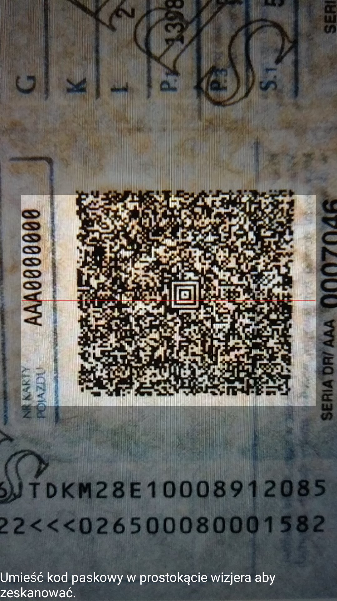
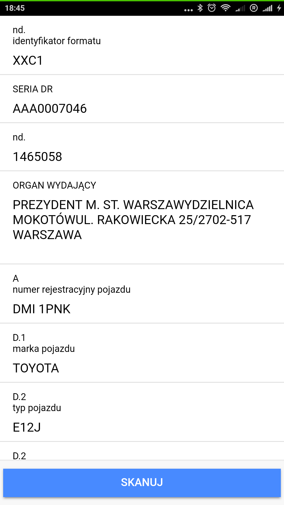

# dekoder-dowodu-rejestracyjnego

[](https://github.com/dex4er/dekoder-dowodu-rejestracyjnego/actions/workflows/trunk-check.yaml)
[](https://github.com/dex4er/dekoder-dowodu-rejestracyjnego/actions/workflows/android-debug.yaml)

Aplikacja na Androida i iOS, która skanuje kod Aztec z polskiego dowodu rejestracyjnego
i pokazuje zapisane w nim dane pojazdu i właściciela.



## Środowisko

Wersje narzędzi są przypięte w `mise.toml`. Zainstaluj [mise](https://mise.jdx.dev/)
i w katalogu projektu uruchom:

```sh
mise install
pnpm install
```

To instaluje Node.js, pnpm i JDK. Do budowania aplikacji na Androida potrzebny
jest jeszcze Android SDK, na przykład z Android Studio, ze zmienną
`ANDROID_HOME` wskazującą na jego katalog.

## Uruchomienie w przeglądarce

```sh
pnpm start
```

Strona działa pod adresem <http://localhost:4200/>. Wersja przeglądarkowa nie
ma aparatu: przycisk „Skanuj” zwraca dane przykładowego dowodu rejestracyjnego.

## Testy i sprawdzenia

```sh
pnpm test          # testy jednostkowe
pnpm type:check    # sprawdzenie typów
pnpm lint          # Biome
pnpm trunk:check   # wszystkie lintery Trunk
```

## Android

Zbuduj aplikację webową i przenieś ją do projektu Androida:

```sh
pnpm build
pnpm android:sync
```

Potem jedno z poniższych:

```sh
pnpm android:debug   # android/app/build/outputs/apk/debug/app-debug.apk
pnpm android:run     # instalacja i uruchomienie na urządzeniu lub emulatorze
pnpm android:open    # otwarcie projektu w Android Studio
```

Gotowy plik APK w wersji debug jest też artefaktem każdego przebiegu
[Android debug build](https://github.com/dex4er/dekoder-dowodu-rejestracyjnego/actions/workflows/android-debug.yaml).

## iOS

Potrzebny jest Xcode. CocoaPods instaluje `mise install`.

```sh
pnpm build
pnpm ios:sync
```

Potem jedno z poniższych:

```sh
pnpm ios:open        # otwarcie projektu w Xcode i uruchomienie stamtąd
pnpm ios:run         # instalacja i uruchomienie na symulatorze lub urządzeniu
pnpm ios:simulator   # sam build na symulator
```

Na symulatorze nie ma aparatu ani skanera: przycisk „Skanuj” zwraca dane
przykładowego dowodu rejestracyjnego, jak w przeglądarce.

## Licencja

GPL-2.0, zobacz [LICENSE.txt](LICENSE.txt).
